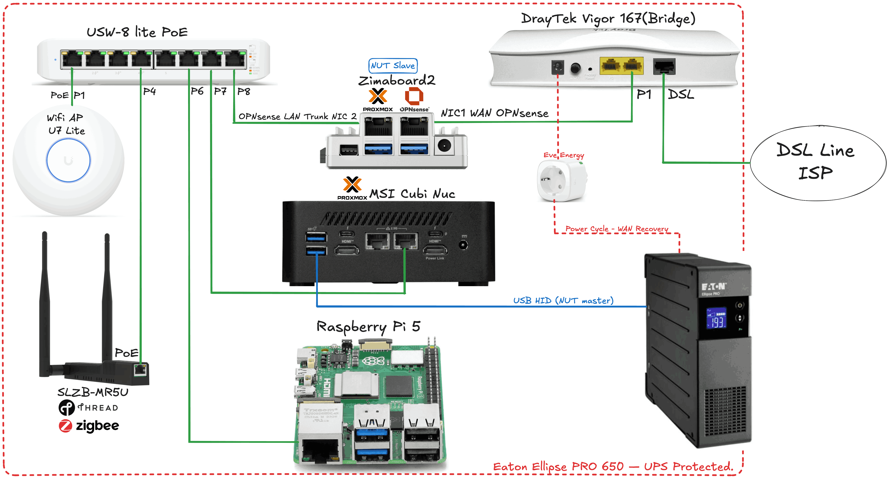

# kuzlab.dev — My Home Lab

I run this home lab for my network, photos, documents and home automation. Here I share how it is put together, why I made certain choices, and what I learned when things went wrong.

An MSI Cubi runs the applications in Proxmox VMs and Linux containers. A separate ZimaBoard runs OPNsense for routing and firewalling. A Raspberry Pi provides a second DNS server and monitoring outside the applications host. The lab also hosts Workbench (AI agent harness), my workspace for AI agents and recurring tasks.

The router used to share a host with the applications. Moving it to its own machine means I can work on Cubi without taking down routing too. DNS now runs on both Cubi and the Raspberry Pi, although they still share the switch and power setup.

The physical layout is shown above; the NUT annotations still reflect an earlier configuration.

## How it is put together

| Area | How it works here |
| --- | --- |
| **Virtualisation and Linux** | Two Proxmox hosts run VMs and Debian LXC containers. The Raspberry Pi runs supporting services separately. I administer the lab from my Mac over SSH. [Hardware](SETUP.md) · [Access model](docs/network-and-access.md#administration) |
| **Networking** | OPNsense handles routing and firewalling, with a UniFi switch and access point. VLANs separate management, servers, personal devices, IoT and guests. Traffic between them is denied unless a rule allows it. [Network design](docs/network-and-access.md) |
| **DNS and HTTPS** | Technitium DNS runs on Cubi and the Raspberry Pi. Most clients and servers receive both DNS addresses. Caddy provides HTTPS for internal service names using Cloudflare DNS validation. [DNS and access paths](docs/network-and-access.md#names-and-https) |
| **Containers and storage** | Docker Compose defines application stacks, with Portainer and a private Gitea repository used to manage them. Persistent data stays outside Docker's writable layers, inside the owning VM or LXC guest. Native Proxmox backups include the guest and its data. [Services and examples](docs/services.md) |
| **Monitoring** | Uptime Kuma checks reachability, Beszel shows host vitals, Grafana with InfluxDB 3 keeps metric history, and Wazuh collects security events and vulnerability findings. Gatus on the Pi checks services from outside Cubi. Pushover is the main notification channel; ntfy remains for existing integrations. [How the layers fit](docs/services.md#monitoring-and-dashboards) |
| **Backups and power** | Proxmox backups go to a separate local SSD, with selected copies in Backblaze B2. Workbench backups stay local-only. NUT on Cubi monitors the Eaton UPS; the current full shutdown and recovery sequence has not been retested. [Coverage, restores and known gaps](docs/backups-and-recovery.md) |
| **Agent workspace** | Workbench brings different agents into a custom web console for tasks, conversations, team workflows and saved results. [Workbench use cases](docs/workbench.md) |

## Problems I worked through

- **[Backup uploads and internet drops](TROUBLESHOOTING.md#backup-uploads-and-internet-drops).** I had read rclone's `30M` limit as 30 Mbps; it actually allowed roughly 250 Mbps on a 47 Mbps upstream. Changing it to `3.5M` held uploads near 29 Mbps, and the drops stopped during follow-up observation.

- **[A UniFi access point that pinged but would not adopt](TROUBLESHOOTING.md#unifi-adoption-across-networks).** The device was reachable, but could not resolve its controller's name across VLANs. Setting the controller address directly completed adoption; a DNS override made the name resolvable afterwards.

- **[Caddy losing its certificates](Caddy/Caddy.md#what-went-wrong).** Recreating the Docker container without a persistent `/data` directory threw away the certificates and the ACME account. The current deployment keeps that state in a persistent directory inside the Caddy LXC guest.

- **[Remote VR access through OPNsense](docs/virtual-desktop-remote-access.md).** WAN captures showed that the mobile carrier was delivering the connection attempts. Correcting NAT translation, a host alias and missing firewall pass rules got the Quest-to-Mac connection working.

## Daily use

Immich holds my photos, Paperless-ngx my documents, and Vaultwarden and Actual Budget handle passwords and finances. Home Assistant, Node-RED and ESPHome run the smart-home side, including an e-paper dashboard and Bluetooth proxies I flashed myself.

Homepage gives me a directory of services. A separate private website brings together personal dashboards, reports and tools I use to work with the lab.

Most of the early setup was manual, working from project documentation and community scripts. I later moved Docker services into Git-backed Portainer stacks and started using Ansible for a fleet audit and selected setup tasks.

[How SSH access and automation developed](docs/network-and-access.md#administration)

## Workbench — an agent harness with a custom web console

Workbench is where I develop and use AI agents for my own projects and recurring tasks. It runs on a dedicated VM, with a custom task service and web console that I build with AI coding tools.

The harness organises the work around the agents: requests, project context, conversations and saved results. I can submit a task, follow its progress and return to it later. Work runs on the server, so my Mac does not need to stay open.

Codex and Claude are the main working agents. They connect through separate adapters: Codex through its app-server and Claude through the Agent Client Protocol (ACP). There is also a Gemini integration for reviewing supplied material. The adapter layer gives me a way to add and test other assistants while keeping the same console.

For larger tasks, a planning step divides the work, workers receive focused instructions in separate conversations, and a final step brings their findings together. Relevant results pass between steps, without giving every agent the full conversation history.

Recurring workflows include document metadata triage in Paperless and reports from Wazuh findings. Other jobs use ordinary scripts and collectors where a model is not needed. Workbench works within assigned projects and integrations, without general administrative access to the lab.

This is the part of the lab I am actively developing: trying different models, improving how agents share work, and making longer tasks easier to follow and resume.

[Workbench use cases](docs/workbench.md) · [How Workbench works](docs/workbench-internals.md)

The [changelog](CHANGELOG.md) records how the lab got here.

## Look closer

- [Hardware, photos and screenshots](SETUP.md)
- [Network and access](docs/network-and-access.md)
- [Selected services and configuration examples](docs/services.md)
- [Workbench use cases](docs/workbench.md)
- [How Workbench works](docs/workbench-internals.md)
- [Backups and recovery](docs/backups-and-recovery.md)
- [Troubleshooting notes](TROUBLESHOOTING.md)
- [Case study: remote VR access through NAT and firewall rules](docs/virtual-desktop-remote-access.md)

This is a selection of the lab, not a complete inventory or a ready-to-deploy copy. Compose files are examples with the secrets removed, and some screenshots are older than the notes beside them.

[Viacheslav Kuzin on LinkedIn](https://www.linkedin.com/in/kuzin-viacheslav/)
