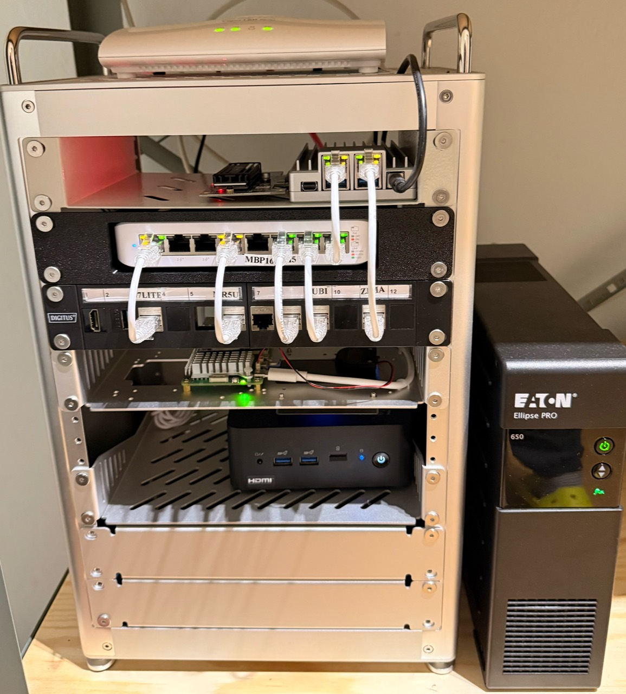

# kuzlab.dev — My Home Lab

I run this home lab for my network, photos, documents and home automation. Here I share how it is put together, why I made certain choices, and what I learned when things went wrong.

An MSI Cubi runs the applications in Proxmox VMs and Linux containers. A separate ZimaBoard runs OPNsense for routing and firewalling. Managed VLANs, internal HTTPS, monitoring and local/off-site backups support the services I use every day.

The router used to share a host with the applications. Moving it to its own machine means I can work on Cubi without taking down routing too. Client DNS filtering still runs on Cubi, so that dependency is not gone yet.

## How it is put together

| Area | How it works here |
| --- | --- |
| **Virtualisation and Linux** | Two Proxmox hosts, with VMs and Debian LXC containers. Everyday SSH access uses keys, aliases and ProxyJump through Cubi. [Hardware](SETUP.md) · [Access model](docs/network-and-access.md#administration) |
| **Networking** | OPNsense does the routing and firewalling, with a UniFi switch and access point. VLANs separate management, servers, personal devices, IoT and guests, and traffic between them is denied unless a rule allows it. [Network design](docs/network-and-access.md) |
| **DNS and HTTPS** | Client devices resolve through AdGuard Home to Unbound; servers use Unbound directly, so infrastructure DNS does not depend on the filtering service. Caddy terminates HTTPS for internal service names using Cloudflare DNS validation. [DNS and access paths](docs/network-and-access.md#names-and-https) |
| **Containers and storage** | Docker Compose defines the applications, managed from Portainer with the compose files in a private Gitea repository. Persistent data lives on host directories and volumes outside the containers — a lesson I learned the hard way with Caddy. [Services and examples](docs/services.md) |
| **Monitoring** | Each tool answers a different question: Uptime Kuma for reachability, Beszel for host vitals, Grafana with InfluxDB 3 for history, Wazuh for CVEs and log events, ntfy for notifications. [How the layers fit](docs/services.md#monitoring-and-dashboards) |
| **Backups and power** | Local Proxmox backups to a separate SSD, selected off-site copies in Backblaze B2, and a separate transfer for the Immich media. An Eaton UPS with NUT handles the shutdown chain. [Coverage, restores and known gaps](docs/backups-and-recovery.md) |

## Problems I worked through

- **[Backup uploads and internet drops](TROUBLESHOOTING.md#backup-uploads-and-internet-drops).** I had read rclone's `30M` limit as 30 Mbps; it actually allowed roughly 250 Mbps on a 47 Mbps upstream. Changing it to `3.5M` held uploads near 29 Mbps, and the drops stopped during follow-up observation.

- **[A UniFi access point that pinged but would not adopt](TROUBLESHOOTING.md#unifi-adoption-across-networks).** The device was reachable, but could not resolve its controller's name across VLANs. Setting the controller address directly completed adoption; a DNS override made the name resolvable afterwards.

- **[Caddy losing its certificates](Caddy/Caddy.md#what-went-wrong).** Recreating the container without a persistent `/data` directory threw away the certificates and the ACME account. The current deployment keeps that state on the host.

- **[Remote VR access through OPNsense](docs/virtual-desktop-remote-access.md).** WAN captures showed that the mobile carrier was delivering the connection attempts. Correcting NAT translation, a host alias and missing firewall pass rules got the Quest-to-Mac connection working.

## Daily use

Immich holds my photos, Paperless-ngx my documents, and Vaultwarden and Actual Budget handle passwords and finances. Home Assistant, Node-RED and ESPHome run the smart-home side, including an e-paper dashboard and Bluetooth proxies I flashed myself.

Most of the early setup was manual, working from project documentation and community scripts. I later moved Docker services into Git-backed Portainer stacks and started using Ansible for a fleet audit and a few service tasks. [How SSH access and automation developed](docs/network-and-access.md#administration)

## What's next

- Move the SSH jump host to the Raspberry Pi, separating the entry point from the applications host. Secondary DNS and independent monitoring are other possible roles to evaluate.
- Fix the application-state backup gap and test another service restore, including its database, files and settings.
- Reduce duplication between dashboards and add longer-term summaries for the metrics.

The [changelog](CHANGELOG.md) records how the lab got here.

## Look closer

- [Hardware, photos and screenshots](SETUP.md)
- [Network and access](docs/network-and-access.md)
- [Selected services and configuration examples](docs/services.md)
- [Backups and recovery](docs/backups-and-recovery.md)
- [Troubleshooting notes](TROUBLESHOOTING.md)
- [Case study: remote VR access through NAT and firewall rules](docs/virtual-desktop-remote-access.md)

This is a selection of the lab, not a complete inventory or a ready-to-deploy copy. Compose files are examples with the secrets removed, and some screenshots are older than the notes beside them.

[Viacheslav Kuzin on LinkedIn](https://www.linkedin.com/in/kuzin-viacheslav/)
