# Hardware, Photos and Screenshots

The equipment behind the lab, and what its dashboards look like.

The screenshots were captured at different times as the lab changed. Treat the numbers in them as a snapshot of that moment rather than a current status.

[Overview](README.md) · [Network](docs/network-and-access.md) · [Services](docs/services.md) · [Changelog](CHANGELOG.md)

## Hardware

| Device | Hardware | Role |
| --- | --- | --- |
| Cubi | MSI Cubi, Intel i5-120U, 40 GB RAM, 1 TB NVMe and 1 TB SATA SSD | Proxmox host for the applications |
| ZimaBoard | ZimaBoard 2 N150, 16 GB RAM, 512 GB NVMe, 2× i226-V 2.5 GbE | Separate Proxmox host for OPNsense |
| Raspberry Pi | Raspberry Pi 5, 8 GB RAM, 512 GB SSD | Installed and reachable; a separate SSH bastion is the next proposed role |
| Modem | DrayTek Vigor 167 | DSL modem in bridge mode |
| Switch | UniFi USW-Lite-8-PoE | Wired connections and VLAN trunking |
| Access point | UniFi U7 Lite | Wi-Fi for personal, smart-home and guest devices |
| UPS | Eaton Ellipse PRO 650 | Backup power and shutdown signalling |
| Zigbee/Thread coordinator | SMLIGHT SLZB-MR5U | Smart-home device connectivity |
| Rack | Waveshare HomeRack 8U, 10-inch | Houses the network equipment and the two hosts |

### Switch ports

Physical port notes from the earlier layout, not a current export of the switch's VLAN profiles:

| Port | Device | Notes |
| --- | --- | --- |
| 1 | U7 Lite access point | PoE and the Wi-Fi VLANs |
| 3 | Break-glass | Management VLAN only, for physical recovery |
| 4 | SLZB-MR5U | Zigbee/Thread coordinator, PoE+ |
| 5 | Wired fallback | Trusted VLAN, for when Wi-Fi is the problem |
| 6 | Raspberry Pi | Second physical machine for future support roles |
| 7 | Cubi | Tagged networks for the applications host |
| 8 | ZimaBoard | VLAN trunk to OPNsense |

Physical layout and earlier design sketches

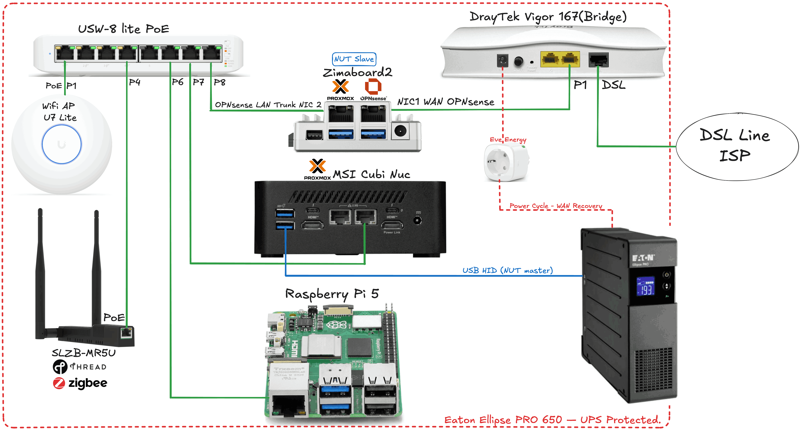

The drawings record earlier stages of the lab. The written [network notes](docs/network-and-access.md) and [service inventory](docs/services.md) describe later changes.

- [DNS and access paths](diagrams/ingress-dns-access.png)
- [VLAN policy sketch](diagrams/vlan-policy-matrix.png)
- [Earlier service map](diagrams/service-map-by-host.png)
- [Power and WAN recovery](diagrams/power-wan-recovery.png)

## Rack

The labelled patch panel helps me trace connections when changing or troubleshooting equipment. November 2026. [Earlier rack photo](photos/HomerackFront-2026-09.jpg).

## Workspace

Desk, displays and the Home Assistant e-paper project

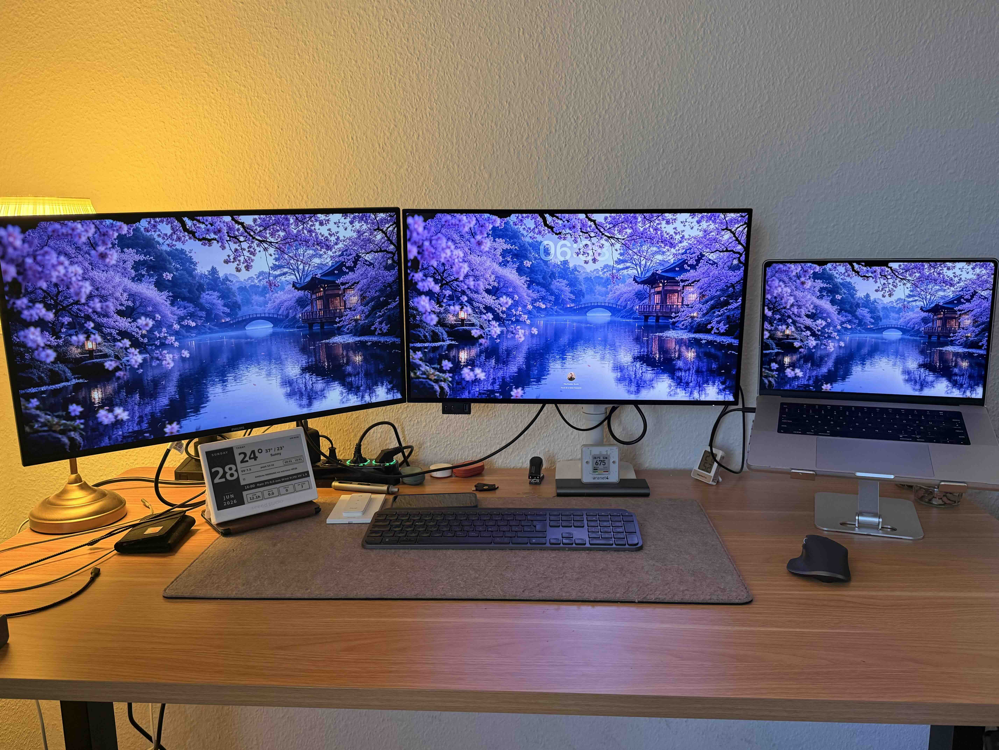

Where I actually work on this: a MacBook Pro with Dell and Philips monitors. The e-paper display is driven by Home Assistant over ESPHome; the small Aranet4 next to it monitors CO2.

## Dashboards

### Homarr

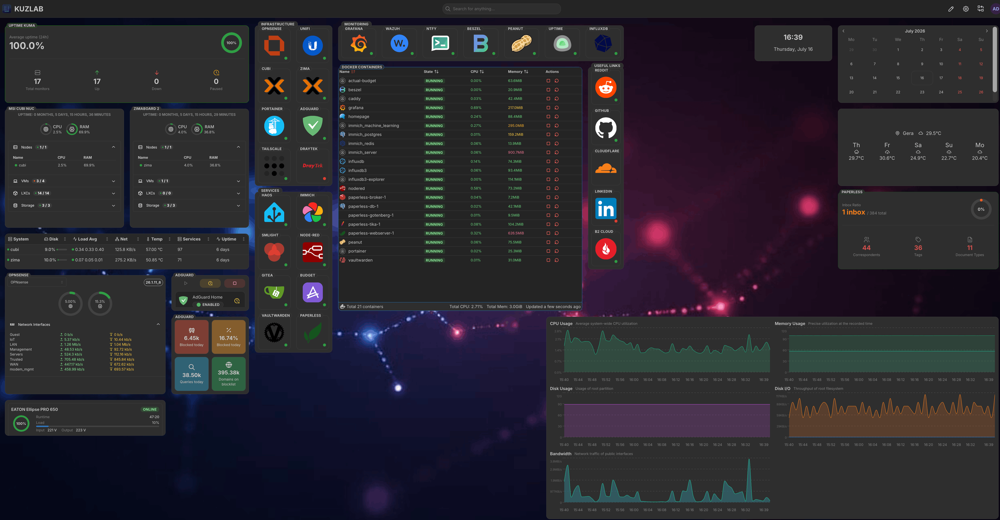

An earlier dashboard with service links, host resources and monitoring widgets. Homarr was retired in October 2026; the current Homepage view is shown below.

### Grafana

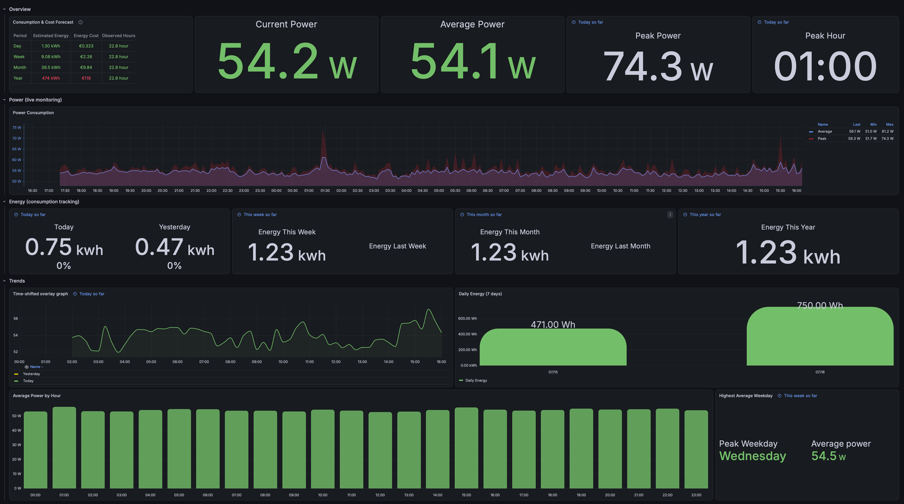

Power use, backed by InfluxDB. The annual figures in this capture were extrapolated from a short observation window, so they are an early estimate rather than measured consumption. [Metrics notes](Metrics/Metrics.md)

### Uptime Kuma

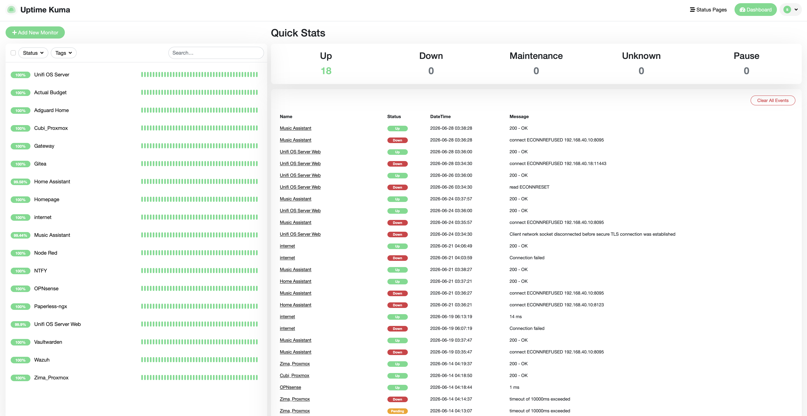

Reachability checks and recent events, with failures pushed to ntfy. The event history is useful for comparing an outage with a backup or maintenance window.

## More screenshots

Management interfaces and earlier dashboards

### Homepage

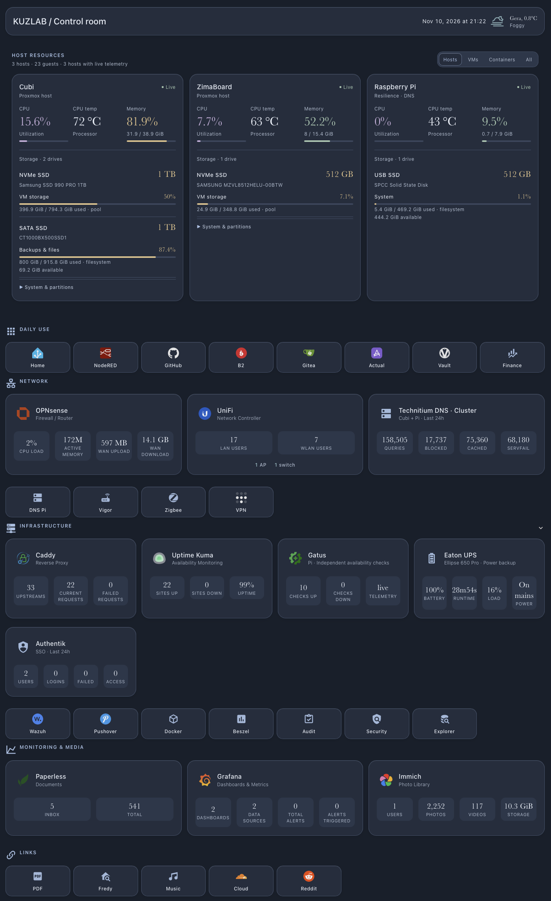

Homepage combines service links and status widgets with a custom resource panel for Cubi, ZimaBoard and Raspberry Pi. This capture is from 10 November 2026. [Earlier Homepage layout](screenshots/Homepage.png).

### Portainer

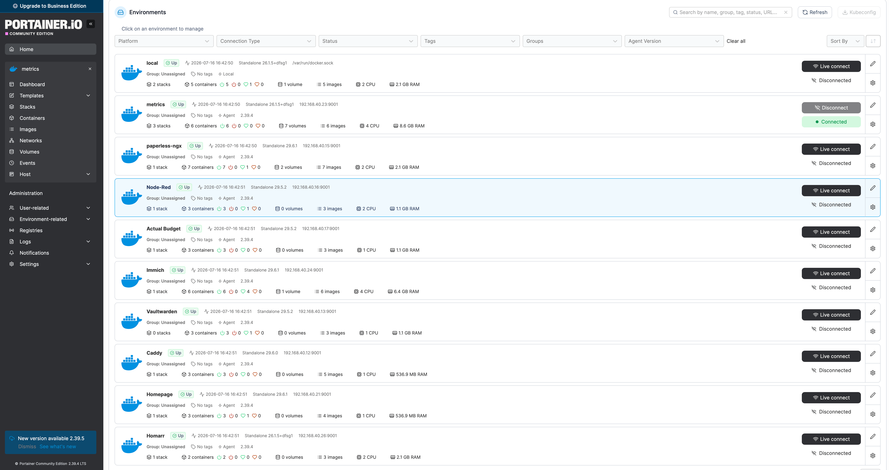

Every Docker LXC runs its own daemon; Portainer's agents bring them into one interface.

### Proxmox — Cubi

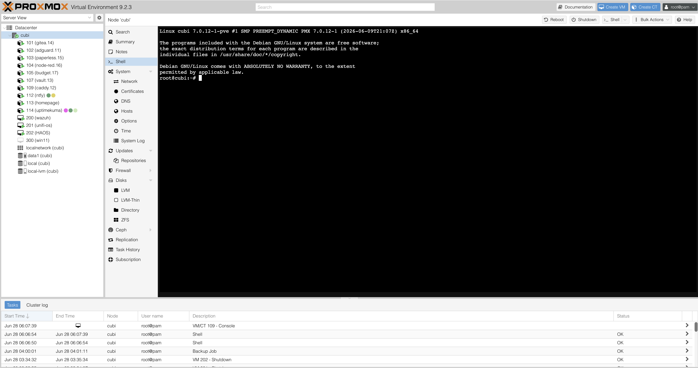

The applications host, with its guest list and task history.

### Proxmox — ZimaBoard

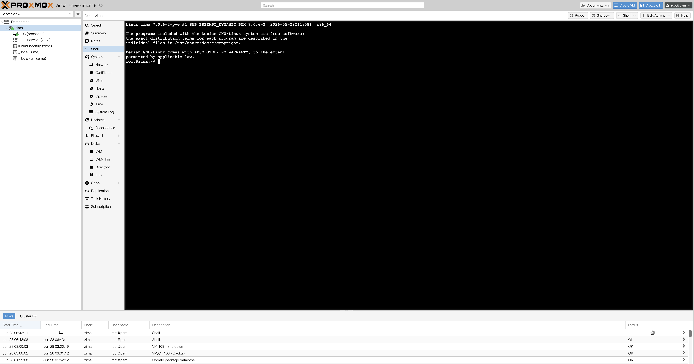

The firewall host. One VM, on purpose — its job is to keep routing while I work on everything else. [Backup schedule](docs/backups-and-recovery.md)

### Home Assistant

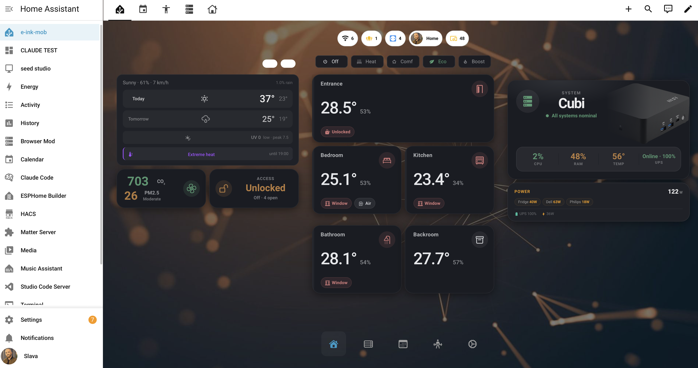

Host, network and UPS information pulled into Home Assistant alongside the home automation. [Home-automation notes](HomeAssistant.md)

### OPNsense

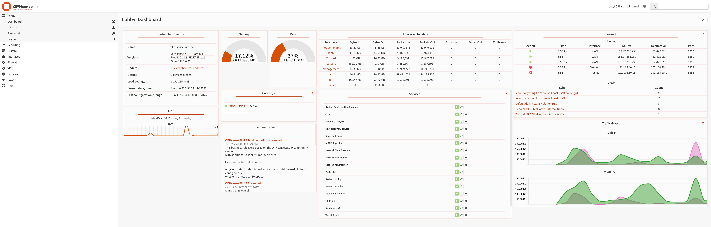

The router dashboard. The firewall policy itself is in [firewall-rules.csv](OPNsense/firewall-rules.csv).

### AdGuard Home

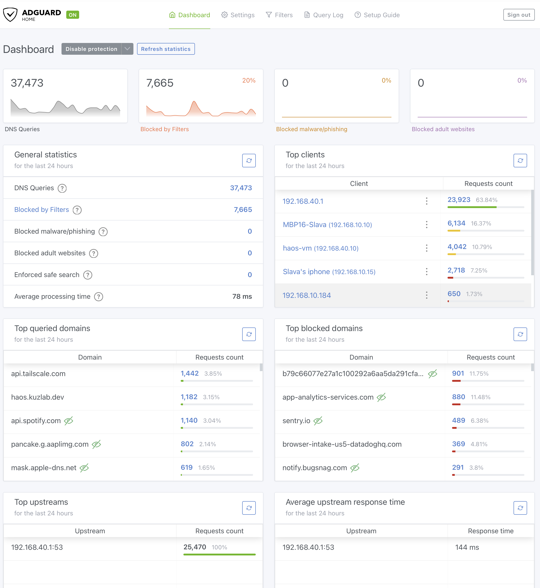

DNS filtering for the client VLANs. Servers deliberately bypass it and query Unbound directly.

### UniFi Network

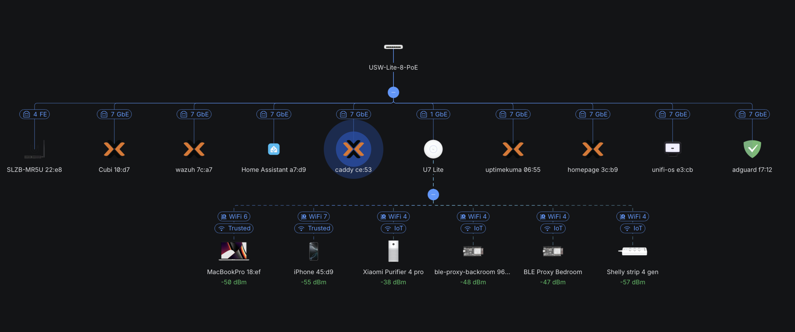

The controller's view of wired and wireless clients. Virtual machines can appear as separate clients behind one physical port, so this is not a literal cable diagram. [The adoption problem](TROUBLESHOOTING.md#unifi-adoption-across-networks)

[Back to the overview](README.md)
