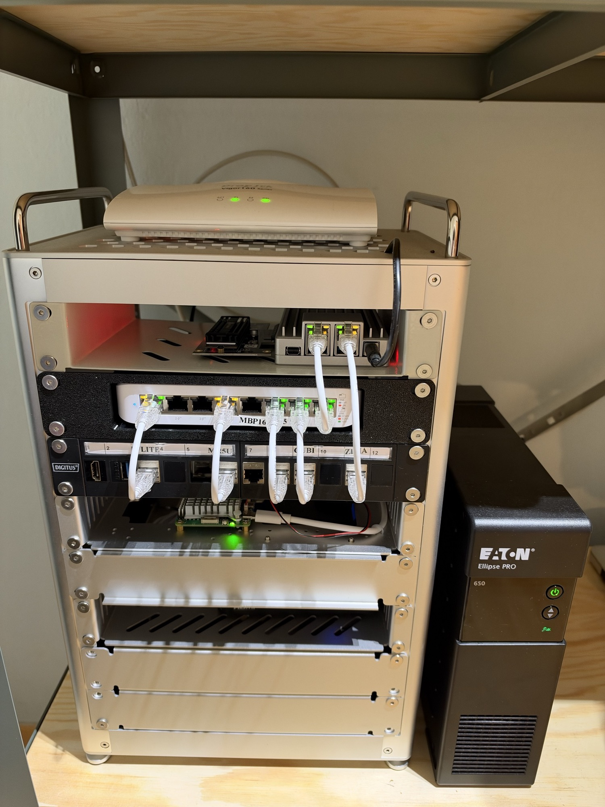
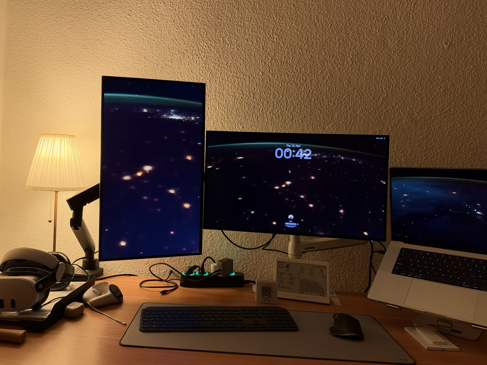
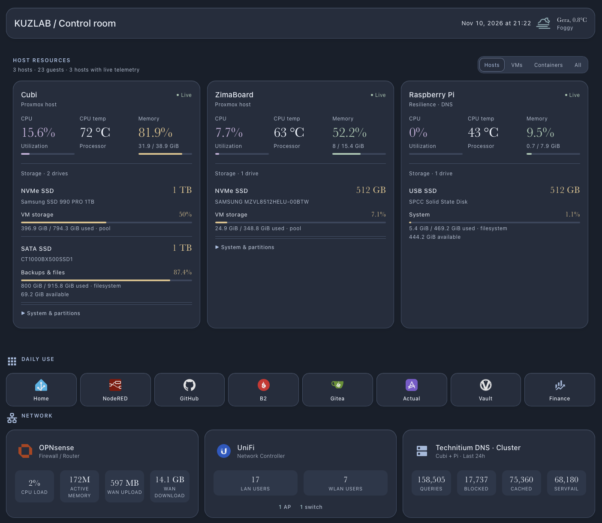

# Hardware and Setup

The equipment behind my home lab, where the services run, and the dashboard I use to keep an eye on it.

Host hardware and service placement checked on 10–11 November 2026.

[Overview](README.md) · [Network](docs/network-and-access.md) · [Services](docs/services.md) · [Workbench](docs/workbench.md) · [Changelog](CHANGELOG.md)

The rack in November 2026. The labelled patch panel helps me trace connections when changing or troubleshooting equipment.

## Hardware

| Device | Hardware | Role |
| --- | --- | --- |
| Cubi | MSI Cubi NUC 1M, Intel Core 5 120U, 40 GB DDR5, 1 TB NVMe and 1 TB SATA SSD | Proxmox applications host |
| ZimaBoard | ZimaBoard 2, Intel N150, 16 GB RAM, 512 GB NVMe, two Intel I226-V 2.5 GbE ports | Separate Proxmox host for OPNsense |
| Raspberry Pi | Raspberry Pi 5, 8 GB RAM, 512 GB USB SSD | Secondary DNS and independent availability monitoring |
| Modem | DrayTek Vigor 167 | DSL modem in bridge mode |
| Switch | UniFi USW-Lite-8-PoE | Wired connections, PoE and VLAN trunking |
| Access point | UniFi U7 Lite | Wi-Fi for personal, smart-home and guest devices |
| UPS | Eaton Ellipse PRO 650 | Backup power, monitored through NUT on Cubi |
| Coordinator | SMLIGHT SLZB-MR5U | Zigbee/Thread connectivity |
| Rack | Waveshare HomeRack 8U, 10-inch | Network equipment and hosts |

Cubi uses a Samsung 990 PRO NVMe and a Crucial BX500 SATA SSD. The Raspberry Pi boots from its USB SSD.

## Where things run

Cubi runs most of the lab. Keeping OPNsense on ZimaBoard lets me work on the applications host while routing stays on its own machine. The Pi provides a second DNS server and availability checks outside Cubi, although the machines still share network and power equipment.

| Location | Main services |
| --- | --- |
| Cubi — application containers | Immich, Paperless-ngx, Node-RED, Actual Budget, Vaultwarden, Gitea, Stirling-PDF and Fredy |
| Cubi — web services | Caddy and the private application, Homepage, Finance Hub and Authentik |
| Cubi — monitoring and management | Grafana, InfluxDB and Explorer; Portainer, Beszel and PeaNUT; Uptime Kuma |
| Cubi — DNS | Primary Technitium DNS |
| Cubi — dedicated VMs | Home Assistant OS, UniFi OS, Wazuh and Workbench |
| ZimaBoard | OPNsense VM |
| Raspberry Pi | Secondary Technitium DNS, Gatus checks and scheduled backups of the Pi itself |

I administer the infrastructure from the Mac. Scheduled maintenance runs on Cubi; Workbench handles personal agent sessions and analysis. [How Workbench fits together](docs/workbench-internals.md).

## Workspace

My workspace in November 2026: a MacBook Pro with two external monitors. The e-paper display is driven by Home Assistant through ESPHome; the small Aranet4 next to it monitors CO₂. [Home-automation notes](HomeAssistant.md)

## Homepage

Homepage is my infrastructure landing page. I added a resource panel for Cubi, ZimaBoard and Raspberry Pi above the service links and status widgets. It brings together host resources, DNS, availability checks and UPS readings.

The preview shows the top of the page on 10 November 2026. [Open the full screenshot](screenshots/Homepage-2026-11.png).

[Back to the overview](README.md)
