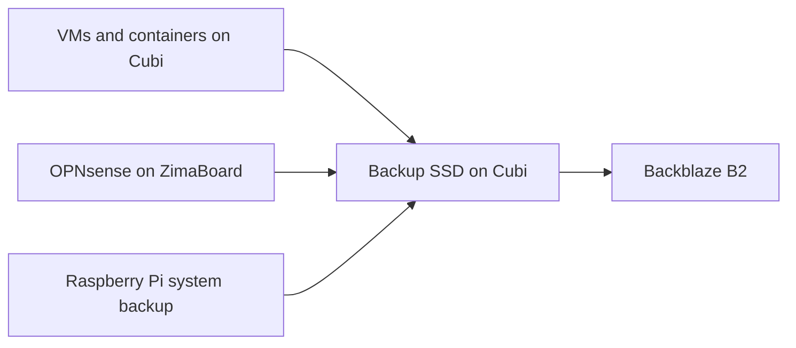

# Backups and Recovery

I keep full backups of my VMs and containers on a separate SSD in Cubi, with another copy in Backblaze B2. Local copies are useful for a quick restore; B2 keeps a copy outside the house.

[Overview](../README.md) · [Services](services.md) · [Troubleshooting](../TROUBLESHOOTING.md)

## What I back up

| System | Local backup | Cloud copy |
| --- | --- | --- |
| VMs and containers on Cubi | Full Proxmox backups on a separate SSD | Backblaze B2 |
| OPNsense on ZimaBoard | Full VM backup sent to Cubi over NFS | Backblaze B2 |
| Raspberry Pi | System backup made with raspiBackup and stored on Cubi | Backblaze B2 |

The check on 12 November 2026 confirmed at least one verified cloud copy for all 23 Proxmox guests and the Raspberry Pi. This includes Workbench (AI agent harness), Finance Hub, Authentik and the Windows VM.

Application data and settings stay inside their VM or container. For Immich, that means the photos, database and configuration are included together in the full container backup.

## Schedule

All times are local to Berlin.

| Job | Schedule |
| --- | --- |
| Raspberry Pi | Monday, Wednesday and Friday at 02:00 |
| OPNsense VM | Monday, Wednesday and Friday at 03:00 |
| Main services and VMs | Monday, Wednesday and Friday at 03:30 |
| Other containers, including Finance Hub | Monday and Wednesday at 04:00 |
| Immich | Monday, Wednesday and Friday at 04:30 |
| Transfer to B2 | Monday, Wednesday and Friday at 08:00 |
| Windows VM | Monthly |

Some guests are stopped while their backup runs. These are scheduled maintenance windows.

## Cloud copies and checks

The cloud job checks the latest completed local backups. If the same verified copy is already in B2, it is left in place. New or missing copies are uploaded, then downloaded and compared with the local backup.

New uploads are encrypted before they leave Cubi. Older verified copies stay in place; the upload job does not delete existing cloud copies.

Upload speed is limited so backups leave bandwidth for the rest of the house. That setting came from an [earlier problem with backup uploads and internet drops](../TROUBLESHOOTING.md#backup-uploads-and-internet-drops).

## Restore experience

I previously restored Home Assistant into a different VM ID, and it came back. That gave me a useful recovery test for that setup.

The recent cloud checks confirm that the verified copies match the local backups. Restoring the current VMs and checking that their applications can open their data is the next practical test.

I also still need to confirm that I can recover the encryption key without Cubi.

## Power and internet failures

An Eaton Ellipse PRO 650 supplies backup power, and NUT on Cubi monitors it.

I tested shutdown and automatic recovery when I built the earlier setup. The lab has changed since then, so the complete current sequence still needs to be retested. The [earlier power and WAN recovery diagram](../diagrams/power-wan-recovery.png) records that arrangement.

The internet-drop incident also led me to add a recovery path for the modem: a software restart first, then a power cycle through a Home Assistant-controlled smart plug. The [troubleshooting story](../TROUBLESHOOTING.md#backup-uploads-and-internet-drops) explains what happened and what I changed.

Passwords, recovery keys and appliance backups are not published here.
