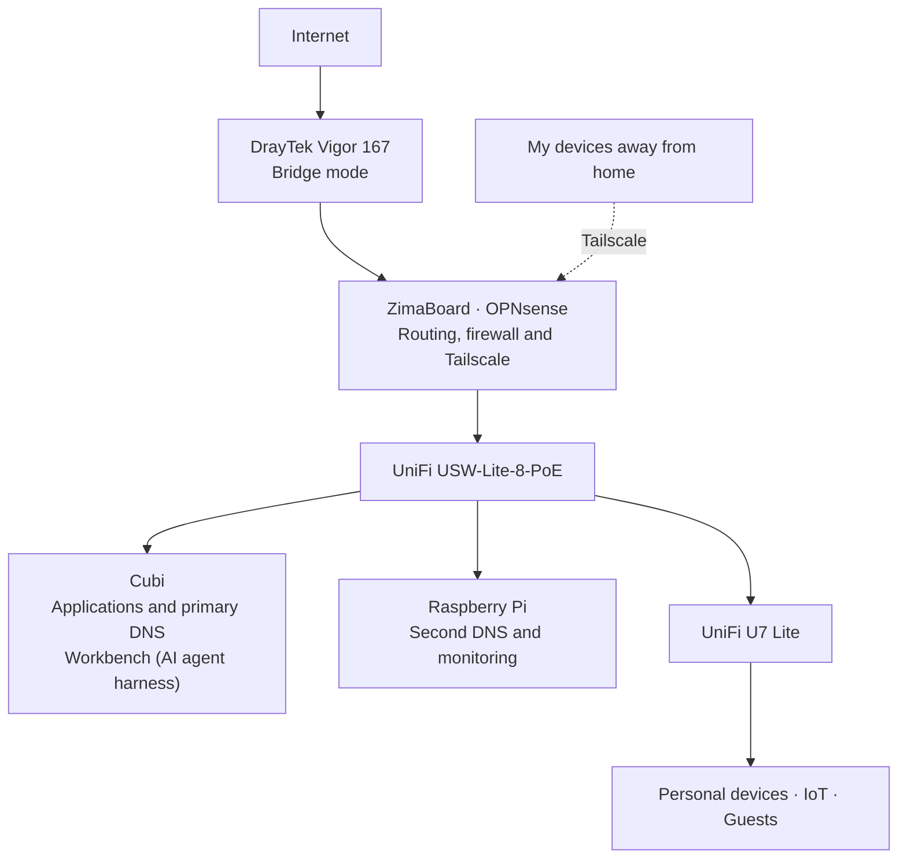

# Network and Access

I keep routing on the ZimaBoard and most applications on Cubi, so working on the server doesn’t take the home internet down. Devices are split into separate networks, with access between them where it’s needed.

[Overview](../README.md) · [Hardware](../SETUP.md) · [Services](services.md)

## The main path

A DrayTek Vigor 167 modem connects to OPNsense, running as a VM on the ZimaBoard. OPNsense handles the internet connection, routing and firewall rules. A UniFi USW-Lite-8-PoE switch connects the wired equipment, and a U7 Lite provides Wi-Fi.

The Pi runs a second DNS server alongside monitoring. That gives the network another way to resolve names when the primary DNS on Cubi is unavailable.

## Network groups

VLANs let me separate devices while using the same switch and access point.

| Network | VLAN | What it’s for |
| --- | --- | --- |
| Management | 99 | Router, Proxmox hosts and network equipment |
| Servers | 40 | Applications and supporting services |
| Trusted | 10 | Personal computers and phones |
| IoT | 20 | Smart-home devices |
| Guest | 30 | Guest Wi-Fi |
| Automation | 50 | Workbench (AI agent harness), with limited access to the rest of the lab |

OPNsense controls connections between these networks. Home Assistant needs to reach smart-home devices, clients need DNS, and my Mac needs access to management interfaces. Guest devices don’t need access to the applications or equipment settings.

[Workbench](workbench.md) has its own segment. I can connect to it to work with agents, but those agents don’t have general administrative access to the lab.

Zenarmor provides another view of network activity. Its reports are collected automatically, and Workbench produces a daily analysis of those saved reports. That analysis doesn’t change firewall rules or block devices.

## Names and HTTPS

Most devices use two Technitium DNS servers: one on Cubi and one on the Raspberry Pi. I’ve tested name resolution during a brief stop of the primary server.

Most application names under `kuzlab.dev` lead to Caddy. It provides HTTPS and forwards requests to the right service, so I can use names instead of remembering addresses and ports.

Caddy uses Cloudflare’s DNS API to validate certificates. The applications can stay accessible through the home network and Tailscale without being opened to the internet.

Authentik provides a shared sign-in for the applications I’ve connected to it. Other services keep their own login.

## Administration

I started with manual SSH connections and key-based access. As the lab grew, I added SSH aliases and used Cubi as a jump host to reach the other machines. Ansible handles repeatable tasks from my Mac.

For these connections, the private keys stay on the Mac. Cubi relays the connection using SSH ProxyJump.

| What I’m doing | How I connect |
| --- | --- |
| Opening an application | Its HTTPS address through Caddy |
| Managing a guest over SSH | Mac → Cubi → target machine |
| Connecting from away | Tailscale on OPNsense → allowed services or machines |
| Opening a container shell from its host | Proxmox console or `pct enter` |

Scheduled jobs also run on the servers themselves. For example, Cubi collects audit data through a separate, restricted access path.

Tailscale provides remote access to selected services and machines, including Workbench and the Pi. It runs on OPNsense, keeping the VPN separate from the application server.

## When something stops working

Keeping the router separate means a Cubi shutdown doesn’t stop routing or the VPN. Applications on Cubi are still unavailable, but the Pi provides another DNS server.

Local administration doesn’t need Tailscale or a working internet connection. Direct management addresses and the Proxmox console provide ways to investigate when application names or guest SSH aren’t working.

If the home internet goes down, Healthchecks.io notices that the Pi has stopped checking in and sends a Pushover notification from outside the home network.

A separate [remote VR experiment](virtual-desktop-remote-access.md) describes using port forwarding for Virtual Desktop. My usual remote access is through Tailscale.
