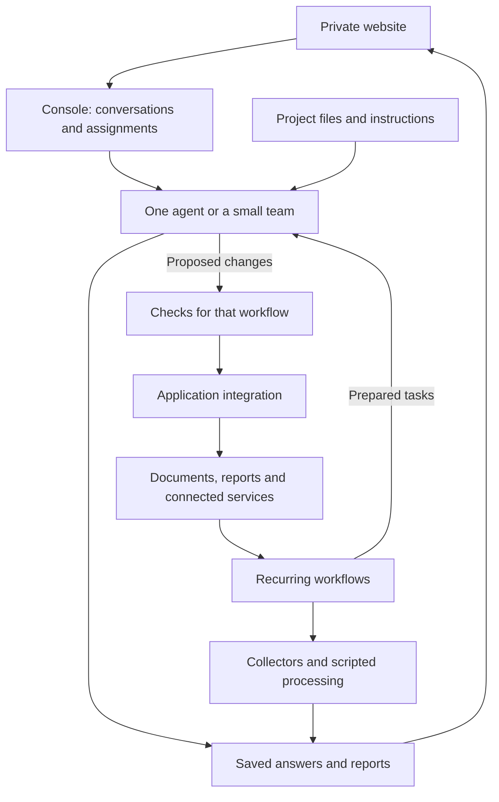
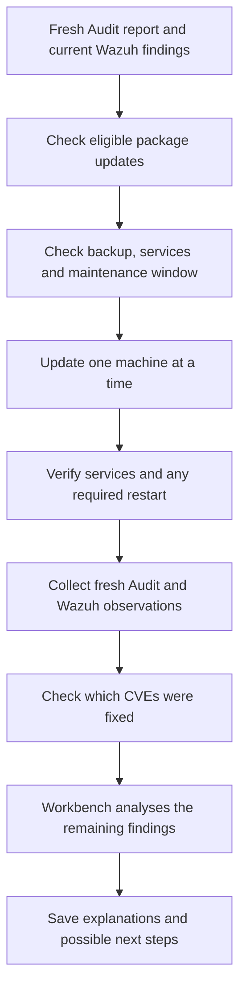

# How Workbench works

Workbench is an AI agent harness that combines a custom console, native agent sessions and separate workflows for recurring tasks. It runs on a dedicated virtual machine, with a browser interface inside my private website.

I build the application and its integrations with AI coding tools. This page explains the parts around the agents: how work gets its context, how tasks move forward and how results are kept.

**[What I use Workbench for](workbench.md)**

## The main components

Console is a TypeScript application that manages conversations and assignments. Adapters connect it to the agents. Recurring workflows prepare their own inputs and decide when their work is due.

The diagram shows two routes through recurring work. Some jobs use ordinary processing. Others prepare a task for an agent. A workflow can combine both.

Applications such as Paperless and Actual remain responsible for their own records. The website brings their results together without replacing those applications.

## The console

The console gives me four ways to return to the work.

| View | Purpose |
| --- | --- |
| **Assignments** | Explicit tasks that are unfinished or need my attention. |
| **Chats** | Conversations with agents, including follow-up questions and continued work. |
| **History** | Earlier conversations, completed assignments and cancelled work. |
| **Automations** | Recurring workflows, recent runs, schedules and source information. |

An assignment keeps its request, criteria, conversation and result together. Team assignments also show the plan and individual steps.

Automations is a view across existing processes. Each workflow keeps its own schedule and records. The console shows the information and actions that the particular integration provides.

## Projects and context

Different kinds of work live in separate projects with their own instructions and materials.

Project files hold information that needs to last beyond one conversation. The conversation contains the current discussion. When another agent joins a task, it receives a focused brief and selected material.

Useful decisions can be saved with their source and brought into another conversation explicitly. This lets me reuse a conclusion without copying the full history that produced it.

Recurring jobs may receive a prepared packet instead of access to a whole project. For example, a document-processing task needs the selected document text and its instructions.

## Agent connections

Codex, Claude and Gemini use separate adapters.

| Agent connection | How it connects |
| --- | --- |
| **Codex** | Its native app-server interface. |
| **Claude** | An adapter using the Agent Client Protocol, or ACP, with the installed Claude client. |
| **Gemini** | An ACP connection for Gemini CLI, or a separate streaming connection for the text consultant. |

Codex and Claude are the main working agents. Gemini’s role in teams is reviewing supplied material.

The console exposes the models and settings supported by each connection. Trying another model within an existing integration is different from adding a new assistant, which may need its own adapter and checks.

The agent keeps its native tools and permissions. Workbench provides the surrounding task and conversation management.

## The task queue

An assignment contains the request, criteria, project and assistant settings. I can also give it a priority and an optional start time.

The server saves the assignment before sending it to an agent. It checks whether the task is due and whether capacity is available, then starts the work.

The browser is only the interface to that queue. Closing it does not remove a task or stop the server from handling eligible work.

When an answer is ready, it is saved with the conversation. I can review it, continue the discussion or record that it meets the assignment’s criteria. Reading an answer and completing an assignment are separate actions.

## Working with a team

A team begins with a planning step. The plan contains a limited set of tasks and identifies which ones depend on earlier results.

Each step starts in a separate conversation. It receives the original goal, its own brief and selected outputs from the steps it depends on. A fresh final conversation combines those outputs into the answer for the original assignment.

Independent research can run in parallel. File-writing steps take turns within the shared project. The conversations have separate context, while still working with the same project files.

Before passing a saved answer to another step, Workbench checks that it belongs to the expected task and has not changed. This preserves the connection between the work performed and the material used in the final answer.

I can open a step’s conversation to answer a question or inspect its work. Pausing a team stops future starts while active steps can finish.

## Recurring workflows and application updates

Recurring workflows have their own triggers, inputs and checks. A timer waking up does not necessarily mean a model is called: there may be no new material, the next research window may not have arrived, or an earlier task may still need attention.

Where a workflow can change an application, the agent produces a proposal. The integration checks it and applies the permitted change.

Paperless is an example:

1. Prepare text from an eligible document.
2. Ask an agent for metadata suggestions.
3. Check the proposal and the current document version.
4. Apply a suitable change or leave it for review.
5. Read back the saved result.

Other workflows end with a report. Wazuh analysis, for example, produces an explanation of saved findings. Fitness and event collection mainly use ordinary processing.

## Audit, updates and remaining CVEs

The maintenance cycle connects Audit, the update controller on Cubi, Wazuh and Workbench.

Cubi runs the controller during the daily maintenance window. It first requires a fresh, successfully collected Audit report and saves the current Wazuh observations for comparison.

The machines come from a registered list. For each one, the package manager identifies available updates, and the controller checks them against the approved rules. It also checks the existing backup, service state and possible conflicts with other operations.

The controller applies the permitted updates and verifies the result, including a restart where required. A deferred machine or an uncertain outcome stays visible in the cycle’s records.

After the update stage, fresh Audit and Wazuh observations provide the comparison. The checks distinguish a finding disappearing from the scanner from a confirmed fix supported by the installed package version and running system. Cases without enough evidence remain unresolved.

Workbench receives the remaining CVE findings once the required post-update evidence is available. Its analysis explains those findings and suggests what to investigate next.

The controller chooses package updates from the approved rules and current package information. Workbench’s analysis does not supply commands for it to execute. Saved results keep the update outcome, CVE verification and subsequent analysis separate, so a completed package update is not mistaken for a fully resolved security finding.

## Saved results and interrupted work

Workbench keeps the connection between a request, its execution and its saved answer. When I review a result, that review refers to the particular answer and criteria.

A later conversation turn or a change to the criteria can make the earlier review historical. The previous answer remains available.

If a connection drops after a request was sent, the system checks the original request rather than immediately sending another copy. An uncertain outcome can hold new queue work until it is understood.

If a Wazuh report has been saved but not delivered, a separate background process can retry delivery without running the analysis again.

Other situations are more straightforward: a task may need my answer, a permission decision or an available provider. The console keeps that state visible so I can return to the right conversation.

Notifications help separate attention from routine activity. Questions and important problems are sent promptly. Ordinary results are grouped into a daily digest, without a separate notification for every internal team step.

## Documentation upkeep

I also use Workbench to keep selected project guides up to date. Checks look for broken links, repeated material and changes that may leave the guides behind.

An agent proposes a correction, and another reviews it. Before saving, the integration checks that the original file has not changed and that the links still work. It then reads the saved file back.

The report shows what changed and what still needs attention.

**[Back to Workbench use cases](workbench.md)**

[Back to the home lab overview](../README.md)
