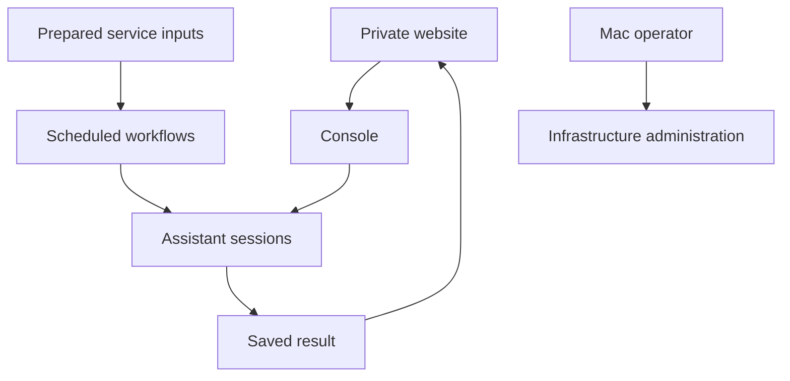

# How I use Workbench in my home lab

When a document arrives in Paperless, I want a useful title, tags and a place in the archive. Workbench receives prepared text from selected documents and proposes that metadata. My integration can apply clear cases under the automatic rules I have enabled. An ambiguous date, a possible duplicate or a document that needs visual inspection stays on the review page. Before applying a change, the integration checks the original document again and then reads back what Paperless actually saved.

Security reports follow a different path. Workbench can analyse a prepared Wazuh report, check relevant sources and save an explanation of findings and possible next steps. I can read that beside the original observations on my private website. The analysis does not itself update packages or change firewall rules. Those operations have their own permissions and verification.

These examples explain why I built Workbench: I wanted the services I already use to produce results I can act on, with the supporting evidence close at hand.

[Back to the overview](../README.md)

## The console behind the website

Workbench runs on a dedicated virtual machine. My Console application connects the private website to assistant sessions, keeps their history, and tracks assignments. The website provides the everyday interface; the console also lets me return to a particular conversation when it needs an answer or a permission decision.

Codex connects through its own app-server interface. Claude connects through an ACP adapter that uses the installed Claude client. The code also includes a Gemini CLI connection through ACP and a separate Gemini text-consultant adapter with its own streaming connection. They do not all use the same protocol, and each assistant retains its own capabilities and account requirements. In a team, Gemini's role is limited to reviewing supplied text.

The console provides sessions and work tracking. Scheduled workflows prepare their own inputs and decide when their work is eligible to run. They can use those sessions, but keep their own schedules, permissions and records. The Automations page brings their observations together; it does not replace their individual processes.

## From a request to an assignment

I can create an assignment with a goal, acceptance criteria, priority and an optional start time. The server keeps the queue moving after I close the browser. Creating a draft or opening a conversation sends nothing. Submitting an assignment queues the requested first turn; it does not change the assistant's existing permissions or approve later tool requests. Account availability, capacity and any required approval still determine whether work can proceed.

Assignments shows unfinished requests, Chats contains the conversations, and History keeps earlier cases and settled work. Recurring workflows show their own source dates and outcomes. This helps me distinguish an old failure from something that is still waiting for attention.

## One agent or a small team

For a larger request, a planner can split the work into at most six steps. Each agent gets a fresh conversation with its task, constraints and selected results from earlier steps. A final session brings those results together into one answer attached to the original assignment.

Two automatic team sessions can work at once, while capacity remains available for manual use. Independent research can overlap; file-writing work takes turns in the shared project. Separate conversations give each agent focused context, while the existing file and tool permissions still apply. I can open an individual step if it asks a question, or pause future starts without interrupting active work.

The installed flow has been exercised with a planner, two Codex steps and a final summary. More demanding tasks still need their own checks; successful coordination alone does not prove that every conclusion is correct.

## Checking the result and recovering work

Before showing an answer as current, the application checks which task and conversation turn produced it. Accepting an assignment records my verification against that exact answer and the current criteria. Reading an answer or receiving a notification does not mark the work complete.

Some recurring work can make specifically permitted changes. Documentation maintenance, for example, can propose a correction to selected non-personal guides, obtain a separate review and check the original file before saving it. The improvement controller can inspect selected technical observations and propose only its supported actions. It has no general authority to administer the lab.

If a connection drops after a request was sent, Workbench looks for the outcome of that same request. It does not send a replacement merely because the reply is missing. Saved answers and earlier attempts remain available for investigation. That recovery behaviour matters as much to me as the first successful run: I want to continue useful work without losing its history or accidentally repeating it.
